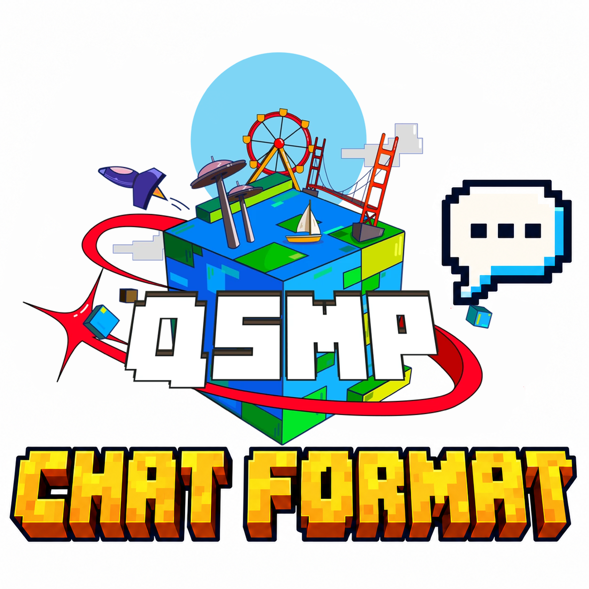

<div align="center">



<h1>QSMP Chat Format</h1>
<p>Chat e avisos de entrada e saída com apresentação inspirada no QSMP.</p>
<p><strong>Minecraft 1.18.2 · Fabric · Java 17</strong></p>

</div>

[Instalação](#instalação) · [Uso](#uso) · [Como funciona](#como-funciona) · [Créditos](#créditos)

## Instalação

Coloque o JAR `build/libs/qsmp-chat-format-fabric-1182-1.0.0.jar` na pasta `mods/` do servidor. O metadado desta variante declara apenas as dependências do loader e do jogo. Quem joga pode entrar com o cliente padrão.

| Minecraft | Loader | Java | Versão do mod |
| --- | --- | --- | --- |
| 1.18.2 | Fabric 0.16.14 | 17 | 1.0.0 |

## Uso

Instale a variante do servidor, entre e envie uma mensagem no chat. Os avisos de entrada e saída aparecem quando jogadores entram ou saem. No single-player, a instância roda o servidor integrado.

```text
Jogador » Olá, pessoal!
[+] Jogador
[-] Jogador
```

## Como funciona

| Situação | Aparência |
| --- | --- |
| Mensagem pública | Nome amarelo, separador `»` cinza-escuro e mensagem branca |
| Entrada | Colchetes cinza, sinal `+` verde e nome branco |
| Saída | Colchetes cinza, sinal `-` vermelho e nome branco |

O servidor aplica a apresentação. Jogadores podem usar um cliente comum. O formato vem definido nesta variante e é aplicado ao inicializar o mundo.

## Créditos

Implementação por [Arthou](https://github.com/arthoou). O visual é inspirado no chat do **QSMP**. Consulte a [licença](LICENSE) deste projeto.

## Compilar

Use um JDK 21 para executar o Gradle e um JDK 17 disponível para a toolchain de compilação desta variante. Para jogar, use o Java indicado na tabela de instalação.

```bash
./gradlew build
```

A saída de distribuição aparece no caminho indicado em **Instalação**.
